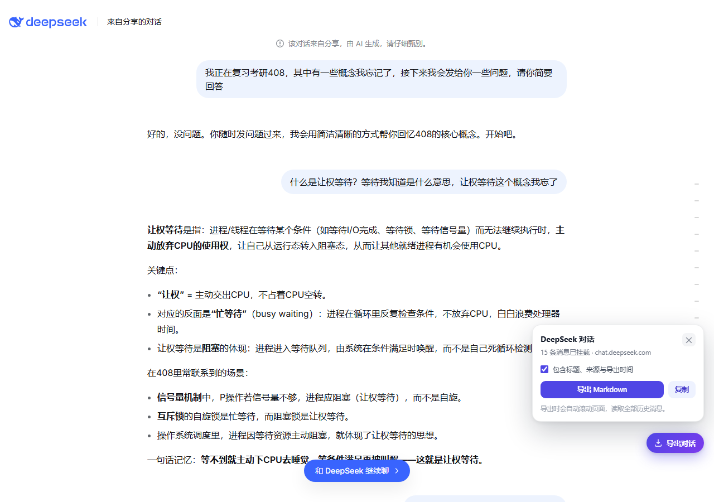
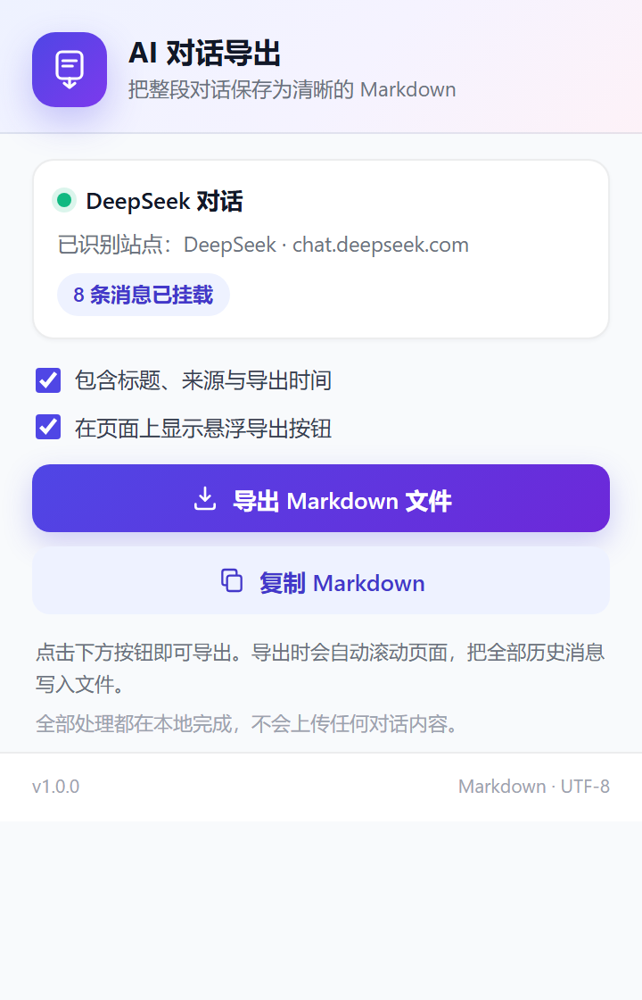

# AI 对话导出器 · Edge 扩展

一键把 DeepSeek、ChatGPT、Claude、Gemini 等 AI 网页里的**整段对话**导出为 Markdown。
自动识别当前站点和 AI 名称，自动滚动读取虚拟列表里的全部历史消息，并保留标题、列表、表格、代码块、公式等格式。





---

## 功能特性

- **自动识别站点与 AI 名称**
  - DeepSeek → `**DeepSeek：**`
  - ChatGPT → `**ChatGPT：**`
  - Claude → `**Claude：**`
  - Gemini → `**Gemini：**`
  - 未识别的站点自动回退为 `**用户：**` / `**AI：**`
- **一次导出全部消息**：长对话使用虚拟列表（只渲染屏幕内消息）也能自动滚动采集，导出后恢复原来的滚动位置。
- **轮次边界清晰**：每条消息前有 `---` 分割线，角色标签加粗，每一轮一眼可见。
- **尽量还原原格式**：标题、加粗、斜体、列表、引用、表格、行内代码、带语言标记的代码块、链接、图片、KaTeX 公式。
- **两个入口**：页面右下角悬浮「导出对话」按钮，或点击 Edge 工具栏里的扩展图标。
- **支持复制**：除了下载 `.md` 文件，也可以直接把 Markdown 复制到剪贴板。
- **完全本地**：不请求任何第三方服务器，不上传对话内容；扩展只保存两个显示选项。

---

## 安装（Edge）

1. 下载并解压 `release/ai-chat-exporter-edge-v1.0.0.zip`（也可以在 GitHub Releases 页面下载）。
2. 在 Edge 地址栏打开 `edge://extensions`。
3. 打开左下角的「开发人员模式」。
4. 点击「加载解压缩的扩展」，选择解压后**包含 `manifest.json` 的那个文件夹**（`ai-chat-exporter`）。
5. 建议点击工具栏的拼图图标，把「AI 对话导出器」固定到工具栏。

> 如果只是本地开发，也可以直接在「加载解压缩的扩展」中选择本仓库根目录（同样包含 `manifest.json`）。

---

## 使用方法

1. 打开任意一段已加载出内容的 AI 对话，例如：
   `https://chat.deepseek.com/a/chat/s/...` 或分享页 `https://chat.deepseek.com/share/...`
2. 页面右下角会自动出现「导出对话」按钮：
   - 点击按钮 → 在面板中点击「导出 Markdown」；
   - 或点击 Edge 工具栏的扩展图标 → 点击「导出 Markdown 文件」。
3. 导出时页面会自动滚动，读取全部历史消息，请稍等几秒；结束后滚动位置会自动恢复。
4. Markdown 文件保存到浏览器默认下载目录，文件名形如：
   `DeepSeek对话_20261109-2124.md`。

### 小提示

- 面板显示的是**当前已挂载**（DOM 中已有）的消息数；导出时会扫描整段对话，最终条数可能更多。
- 如果页面是空白新对话，没有内容可导出；先发送几条消息再试。
- 如果悬浮按钮遮挡了页面内容，可以在扩展弹窗里关闭「在页面上显示悬浮导出按钮」。

---

## 导出格式示例

```markdown
# DeepSeek 对话导出

> **来源**：https://chat.deepseek.com/share/hap0v75jvcj4ck4iyb  
> **导出时间**：2026-11-09 21:24  
> **消息数**：118

---

**我：**

我正在复习考研408，其中有一些概念我忘记了，接下来我会发给你一些问题，请你简要回答

---

**DeepSeek：**

好的，没问题。你随时发问题过来，我会用简洁清晰的方式帮你回忆408的核心概念。开始吧。

---

**我：**

什么是让权等待？等待我知道是什么意思，让权等待这个概念我忘了

---

**DeepSeek：**

**让权等待**是指：进程/线程在等待某个条件（如等待I/O完成、等待锁、等待信号量）而无法继续执行时，**主动放弃CPU的使用权**……

---

**我：**


---

**DeepSeek：**
...
```

- `---` 分割线 + 加粗标签：每一轮的边界非常明确。
- 标题、来源、导出时间可以通过弹窗里的「包含标题、来源与导出时间」开关关闭。
- 图片消息：图片单独成条且有可访问链接时输出 ``；用户“文本 + 图片”时在文本后追加 `[图片：说明]`；blob/data 图片输出为 `[图片]` 占位。
- 文件/附件消息：输出 `[附件：文件名]` 或以图片形式呈现。
- 代码块保留语言标记（如 ```python），公式保留为 `$...$` / `$$...$$`。

---

## 支持的站点

| 站点 | 链接示例 | 识别名称 | 识别方式 |
| --- | --- | --- | --- |
| DeepSeek | `chat.deepseek.com` | DeepSeek | 专用适配器 |
| ChatGPT | `chatgpt.com` / `chat.openai.com` | ChatGPT | 专用适配器 |
| Claude | `claude.ai` | Claude | 专用适配器 |
| Gemini | `gemini.google.com` | Gemini | 专用适配器 |
| Copilot | `copilot.microsoft.com` / `www.copilot.com` | Copilot | 专用适配器（未逐一真机验证） |
| Kimi | `kimi.com` / `kimi.moonshot.cn` | Kimi | 通用识别（未逐一验证） |
| 通义千问 | `tongyi.aliyun.com` / `tongyi.com` | 通义千问 | 通用识别（未逐一验证） |
| Qwen | `chat.qwen.ai` / `qwen.ai` | Qwen | 通用识别（未逐一验证） |
| 豆包 | `doubao.com` | 豆包 | 通用识别（未逐一验证） |
| 智谱清言 | `chatglm.cn` | 智谱清言 | 通用识别（未逐一验证） |
| Z.ai | `chat.z.ai` / `z.ai` | Z.ai | 通用识别（未逐一验证） |
| 腾讯元宝 | `yuanbao.tencent.com` | 腾讯元宝 | 通用识别（未逐一验证） |
| Mistral | `chat.mistral.ai` / `mistral.ai` | Mistral | 通用识别（未逐一验证） |
| Grok | `grok.com` | Grok | 通用识别（未逐一验证） |

> DeepSeek / ChatGPT / Claude / Gemini 的适配器已根据 2025-2026 年真实 DOM 结构和开源实现核对；Kimi、通义、豆包等站点仅做通用识别，尚未逐一真机验证。遇到无法识别时，扩展会明确提示，而不是输出残缺对话。

对于不在列表里的 AI 网页，也可以点击扩展图标尝试导出：扩展会自动进入**通用识别模式**，从常见消息容器（`data-role`、`data-message-author-role`、`*-message` 等）中提取对话。识别不到时，会提示当前页面没有对话内容。

### AI 名称识别顺序

1. 已知站点域名映射（上表）。
2. 页面标题里的品牌关键词（DeepSeek / ChatGPT / Claude / Gemini 等）。
3. 都识别不到 → 使用 `用户：` / `AI：`。

---

## 工作原理（简要）

1. `content.js` 在支持的站点注入，`extractor.js` 使用站点适配器识别消息容器和角色：
   - DeepSeek：`[data-virtual-list-item-key]` + `.ds-message` + `.ds-assistant-message-main-content`
   - ChatGPT：`section[data-testid^="conversation-turn"]` + `data-turn` + `[data-message-author-role]`；CodeMirror 代码取 `.cm-content` / `.cm-line`
   - Claude：`[data-testid="user-message"]` + `.font-claude-response`（兼容旧版 `.font-claude-message`）+ `.standard-markdown`
   - Gemini：`div.conversation-container` 内的 `user-query` / `model-response` + `.query-text` / `.model-response-text .markdown`
2. 导出时从滚动容器顶部滚到底部，逐屏收集消息并按消息 ID / 文本指纹去重，最后恢复原滚动位置。
3. 助手消息通过内置的 HTML→Markdown 转换器还原格式；用户消息优先使用原始文本（保留换行）。
4. 悬浮 UI 使用 Shadow DOM，避免和站点 CSS 冲突；下载通过 Blob + `<a download>` 完成。

---

## 权限与隐私

扩展申请的权限及用途：

- `activeTab` / `scripting`：在你点击扩展图标时，对当前页面做一次临时识别（用于不支持的站点）。
- `downloads`：极少数页面不允许 Blob 下载时，用浏览器下载 API 兜底。
- `storage`：只保存「是否包含标题」和「是否显示悬浮按钮」两个布尔值。
- `clipboardWrite`：点击「复制」时写入剪贴板。
- `host_permissions`：只列出声明的 AI 站点，用于自动注入识别脚本。

**没有任何网络上传代码**：扩展不调用远程接口，不收集统计，不发送对话内容。

---

## 已知限制

- 需要先登录并打开已有对话；未登录或空白新对话没有内容可导出。
- AI 网站改版后选择器可能失效；此时会尝试通用识别，仍无效则提示无法识别。可以在 `src/extractor.js` 的适配器里补充选择器。
- 极长对话需要滚动采集，导出会花几秒到几十秒；期间页面会滚动，结束后恢复。
- 建议等当前 AI 回答生成完成后再导出。扩展会尽量等待懒加载稳定、更新流式消息，但生成中的内容仍可能只导出点击时已生成的部分。
- 导出期间如果页面上方图片突然加载完成、折叠块展开等导致布局高度变化，极端情况下可能出现重复消息；建议等页面完全加载后再导出。
- 极少数站点如果以裸 `` 形式把头像/图标放进消息节点，可能被当作正文图片导出；真实 DeepSeek 对话测试中未出现。
- HTML→Markdown 是对页面渲染结果的近似还原，复杂排版（如嵌套表格、特殊组件）可能与原网页略有差异。
- 图片链接可能来自临时 CDN 或 blob，过一段时间可能失效；需要长期存档建议同时保存原图。
- 浏览器内部页面（`edge://`、`chrome://`、扩展商店等）不允许注入脚本，无法导出。

---

## 开发与测试

### 目录结构

```
ai-chat-exporter/
├── manifest.json          # Edge MV3 清单
├── background.js          # Service Worker（默认设置 + 下载兜底）
├── popup.html/css/js      # 工具栏弹窗
├── src/
│   ├── extractor.js       # 纯 DOM 识别 + HTML→Markdown + 深度扫描
│   └── content.js         # 页面悬浮按钮、消息通信、下载/复制
├── icons/                 # 16/32/48/128 图标
├── docs/                  # 截图与真实导出样例
├── test/
│   ├── fixtures/          # DeepSeek 真实 DOM + ChatGPT/Claude/Gemini/通用模拟页
│   ├── run-tests.mjs      # 无头 Edge 单元/集成测试
│   ├── e2e-test.mjs       # 加载扩展、点击悬浮按钮、验证下载与 popup 流程
│   ├── live-test.mjs      # 真实 DeepSeek 分享页测试（需要联网）
│   └── results/           # 测试输出
├── build.ps1              # 打包脚本
└── README.md
```

### 运行测试

前置：Windows + Edge；临时目录安装 `puppeteer-core`（E2E 用）：

```powershell
$dir = Join-Path $env:TEMP "ace-e2e"
New-Item -ItemType Directory -Force -Path $dir | Out-Null
Push-Location $dir
npm.cmd init -y
npm.cmd install puppeteer-core@24.10.2 --no-audit --no-fund
Pop-Location
```

```powershell
# 1. 站点适配器与 Markdown 转换测试（无头 Edge，28 个夹具）
node test/run-tests.mjs

# 2. 扩展端到端测试（加载扩展、悬浮按钮、下载、popup 导出）
node test/e2e-test.mjs

# 3. 真实 DeepSeek 分享页测试（需要联网）
node test/live-test.mjs
```

测试结果在 `test/results/`，真实导出样例在 `docs/sample-deepseek-export.md`。

### 打包

```powershell
powershell -ExecutionPolicy Bypass -File build.ps1
```

生成 `dist/ai-chat-exporter-edge-v1.0.0.zip`，解压后通过 `edge://extensions` 加载即可。

---

## 常见问题

**Q：为什么导出时页面会自动滚动？**
A：AI 网站为了性能通常只渲染屏幕附近的消息（虚拟列表）。扩展需要从顶部到底部滚动一遍，才能收集全部对话；完成后会恢复原来的滚动位置。

**Q：面板里显示 15 条，为什么导出文件里有 118 条？**
A：面板显示的是当前 DOM 中已加载的消息数。导出时的深度扫描会读取完整历史，所以文件里的条数会更多。

**Q：为什么我的对话里少了一条？**
A：通常是消息只有附件/图片且站点没有可提取的文本；扩展会尽量输出 `[图片]` 或 `[附件：文件名]` 占位。如果仍然缺失，欢迎提供该站点的 DOM 片段来补充适配器。

**Q：导出的图片打不开？**
A：部分图片使用临时签名链接或 blob URL，会过期。建议同时保存原图，或在笔记中保留图片说明。

**Q：会把我对话上传吗？**
A：不会。扩展没有任何网络请求代码，全部处理都在本地浏览器里完成。

---

## License

MIT
